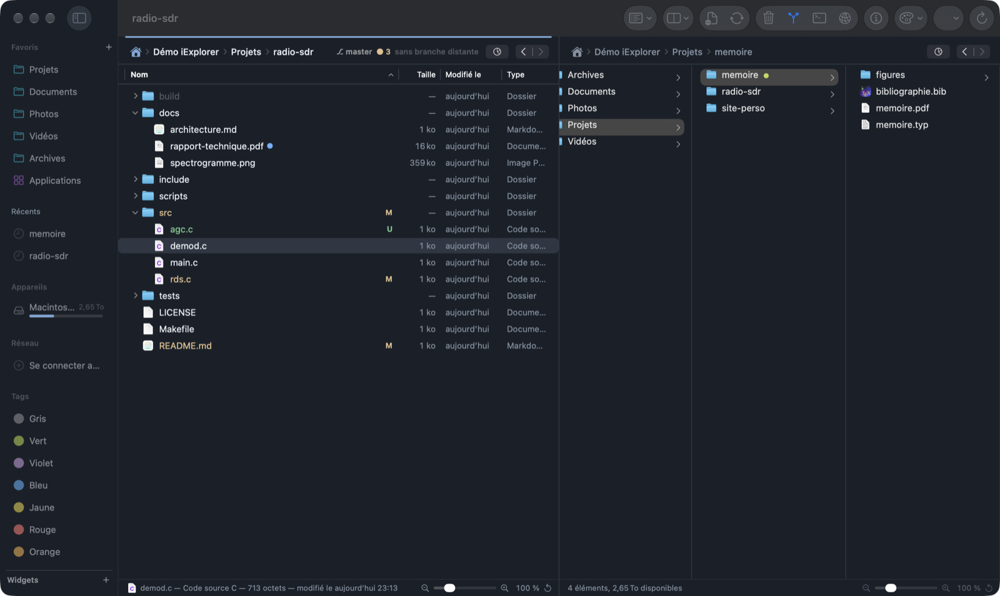
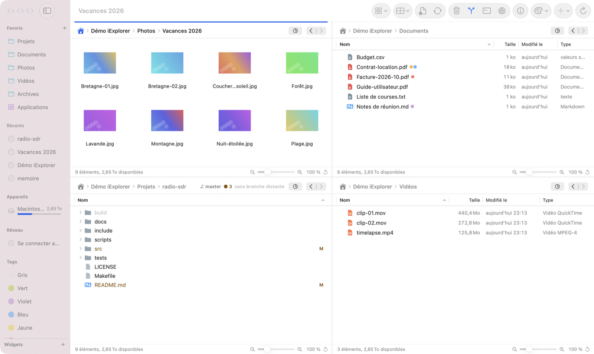
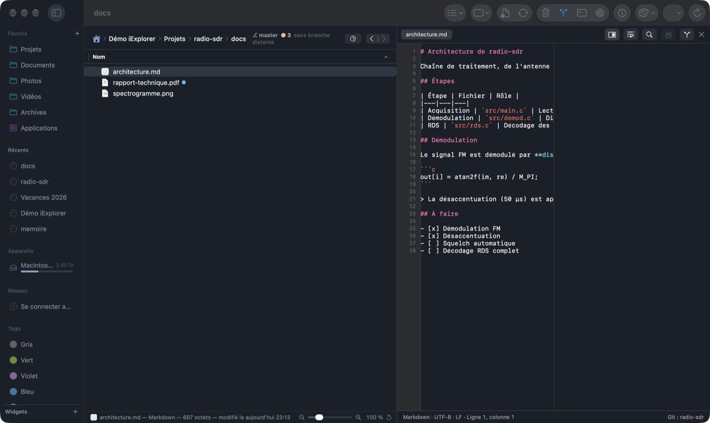
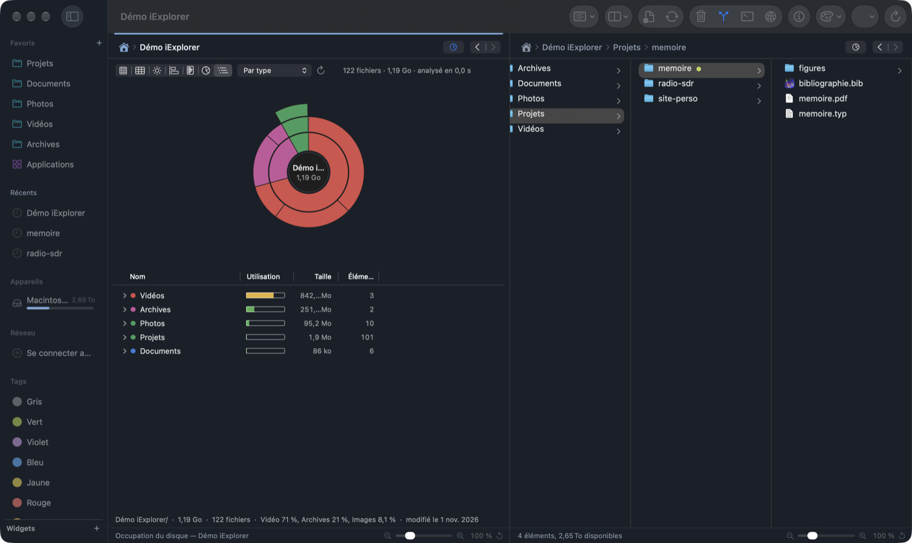
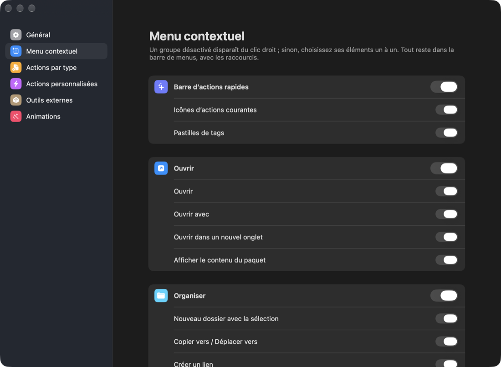
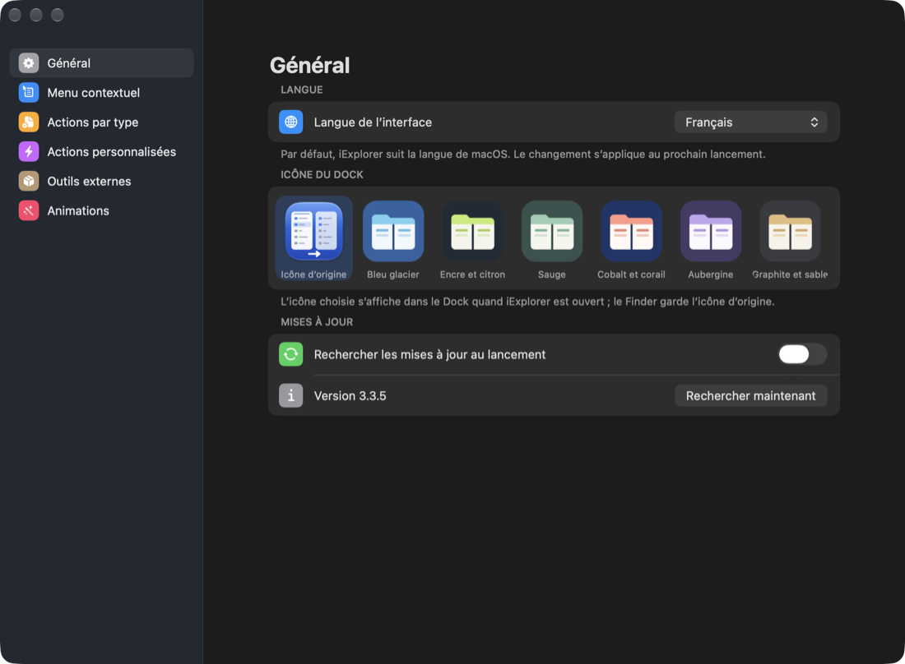
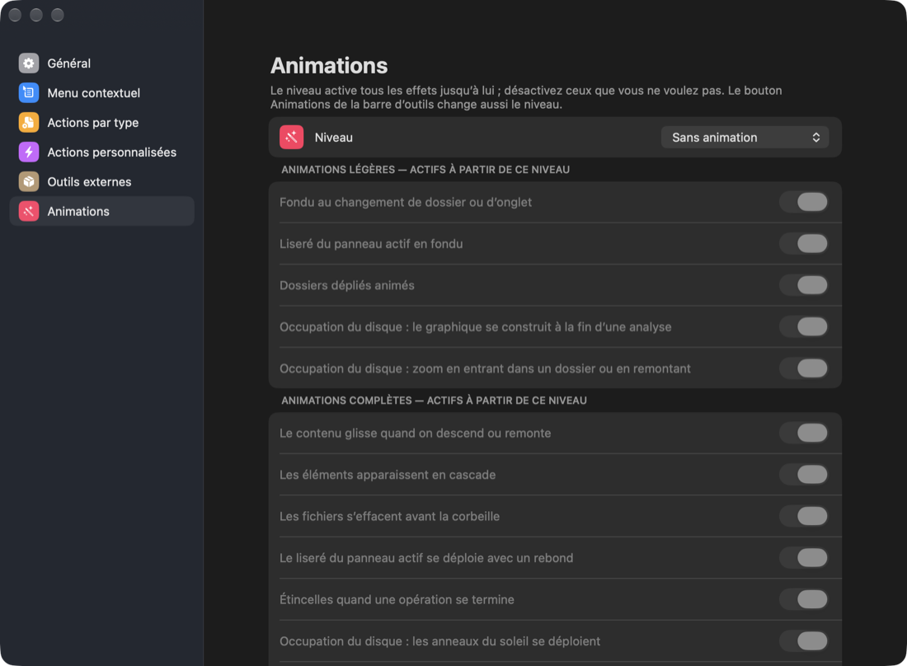

# iExplorer

[English](README.md) · **Français**

**Gestionnaire de fichiers natif pour macOS** : jusqu’à quatre panneaux avec onglets, état Git, éditeur avec aperçu,
terminal intégré, serveurs distants, analyse de l’espace disque et thèmes. Écrit en Swift / AppKit, sans Electron.



## Pourquoi iExplorer ?

- **Plusieurs dossiers sous les yeux.** 1 à 4 panneaux côte à côte, chacun avec ses onglets ; F5 / F6 copient ou
  déplacent vers l’autre panneau, comme dans les gestionnaires de fichiers « à deux volets ».
- **Pensé pour les projets.** L’état Git s’affiche dans les listes, un éditeur avec aperçu s’ouvre à côté des fichiers
  et le terminal intégré suit le dossier courant.
- **Où est passé l’espace disque ?** ⌘5 transforme n’importe quel dossier en graphique d’occupation.
- **À votre goût.** 20 thèmes de couleurs en clair et en sombre, 13 thèmes d’icônes, menu contextuel réglable,
  icône du Dock au choix, animations de discrètes à spectaculaires, interface en français ou en anglais.

## En images

### Quatre panneaux, thème clair

Icônes, détails, liste et colonnes dans la même fenêtre, avec les tags du Finder et l’état Git.



### Éditeur avec aperçu en direct

En disposition simple, l’éditeur s’ouvre à côté du panneau. Un fichier Markdown s’affiche en aperçu seul (double-clic pour modifier à cet endroit), puis texte et aperçu côte à côte ou texte seul (⌃⌘1 … ⌃⌘3) : aperçu Markdown, CSV et JSON en direct, compilation
LaTeX ou Typst avec le PDF à côté, coloration syntaxique de plus de soixante-dix langages.



### Occupation du disque (⌘5)

Le dossier courant en sept graphiques (cartes, soleil, histogramme, liste façon Baobab), animés au niveau choisi.



### Des réglages à votre main

| | |
|---|---|
|  |  |
| **Menu contextuel** : masquez un groupe entier ou des éléments un à un. | **Général** : langue de l’interface, icône du Dock, mises à jour. |



**Animations** : un niveau (aucune, légères, complètes, Whaouh+++) et un interrupteur par effet. « Réduire les
animations » de macOS est toujours respecté.

## Fonctionnalités

**Navigation**
- Interface en français ou en anglais : la langue du système par défaut, réglable dans Réglages › Général.
- 1, 2, 3 ou 4 panneaux (8 dispositions), chacun avec ses onglets colorés et sa barre d’état (sélection, zoom).
- Vues icônes, liste, détails, colonnes et galerie en mosaïque ; dossiers dépliables sur place dans les listes ; regroupement par type, date ou taille ; vue à plat de toute une arborescence ; taille des dossiers calculée en direct.
- Navigation synchronisée entre panneaux, comparaison et synchronisation de dossiers, recherche (nom, contenu, tags).
- Archives (zip, tar.gz, 7z, rar…) parcourues comme des dossiers.

**Fichiers**
- Copies et déplacements en arrière-plan, avec débit, pause et vérification facultative des copies.
- Glisser-déposer entre panneaux, avec le Finder et les autres apps, dans toutes les vues.
- Renommage par lot, tags du Finder, nouveaux documents à partir de modèles, partage, annulation (⌘Z).
- Compression, sommes de contrôle, chiffrement, découpage de gros fichiers ; désinstallation propre d’une app avec ses fichiers dans ~/Library.
- Inspecteur : aperçu du code avec coloration, PDF, images, vidéo et son, permissions (R/W/X, octal, propriétaire).

**Pour les développeurs**
- État Git dans les listes, comme dans VS Code ; indexer, valider, tirer et pousser depuis l’inspecteur.
- Terminal intégré qui suit le dossier du panneau actif.
- Éditeur à côté du panneau en disposition simple : aperçu Markdown, CSV et JSON en direct, compilation LaTeX ou Typst avec le PDF à côté, synchronisation texte ↔ PDF (SyncTeX) et texte ↔ aperçu Markdown par ⌘-clic, lignes modifiées depuis le dernier commit marquées dans la marge, coloration syntaxique de plus de soixante-dix langages (Makefile, CMake, VHDL, Verilog, Tcl et contraintes FPGA, SPICE, Typst, BibTeX, Matlab, Chisel, YAML, Terraform…).
- Actions personnalisées et actions par type de fichier (cibles d’un Makefile, compiler un .typ, convertir un .md…).
- Outils externes facultatifs (7-Zip, unar, pigz, LaTeX, Typst…) installés en un clic via Homebrew.
- Serveurs SFTP, SMB, AFP, NFS et WebDAV.

**Apparence**
- 20 thèmes de couleurs, chacun en clair et en sombre ; apparence automatique, claire ou sombre.
- 13 thèmes d’icônes de fichiers, 7 icônes du Dock.
- Animations à quatre niveaux, réglables effet par effet.

**Espace disque**
- Occupation du dossier courant (⌘5) en 7 graphiques : cartes, soleil, histogramme, liste façon Baobab.
- Mise à la corbeille depuis le graphique, nouvelle analyse en un clic.

## Installation

Nécessite **macOS 15** ou plus récent (l’apparence Liquid Glass demande macOS 26).

Avec [Homebrew](https://brew.sh) :

```bash
brew install --cask blegal/tap/iexplorer
```

Ou à la main :

1. Téléchargez `iExplorer-x.y.z.dmg` depuis la page [Releases](https://github.com/blegal/iExplorer/releases/latest).
2. Ouvrez l’image disque et glissez **iExplorer** dans **Applications**.
3. L’app n’est pas notarisée par Apple : au premier lancement, faites **clic droit › Ouvrir**, puis confirmez.
   Vous pouvez aussi retirer l’attribut de quarantaine :

   ```bash
   xattr -dr com.apple.quarantine /Applications/iExplorer.app
   ```

Les mises à jour sont ensuite automatiques. L’app vérifie les nouvelles versions au lancement, ou à la demande avec
**iExplorer › Rechercher les mises à jour…**. Chaque image disque est signée (Ed25519) et vérifiée avant d’être installée.

### Compiler depuis les sources

Il faut Xcode avec Swift 6.

```bash
git clone https://github.com/blegal/iExplorer.git
cd iExplorer
./build.sh
open build/iExplorer.app
```

## Raccourcis essentiels

| Action | Raccourci |
|---|---|
| Panneau suivant | ⇥ |
| Copier / déplacer vers l’autre panneau | F5 / F6 |
| Renommer | F2 |
| Coup d’œil | Espace |
| Icônes, liste, détails, colonnes | ⌘1 … ⌘4 |
| Occupation du disque | ⌘5 |
| Galerie d’images en mosaïque | ⌘6 |
| 1 à 4 panneaux | ⌥⌘1 … ⌥⌘4 |
| Rechercher | ⌘F |
| Se connecter à un serveur | ⌘K |
| Terminal intégré | ⌃\` |

## En savoir plus

Le [guide détaillé](docs/GUIDE.md) décrit toutes les fonctionnalités et la liste complète des raccourcis. Il explique
aussi le format des actions par type de fichier, la publication des versions et la signature des mises à jour.

L’analyse de l’espace disque et la mise à jour automatique sont partagées avec
[iBaobab](https://github.com/blegal/iBaobab), l’analyseur d’occupation des disques.

## Développement

iExplorer a été développé avec l’aide de [Claude Code](https://claude.com/claude-code), l’assistant de
programmation d’Anthropic.
