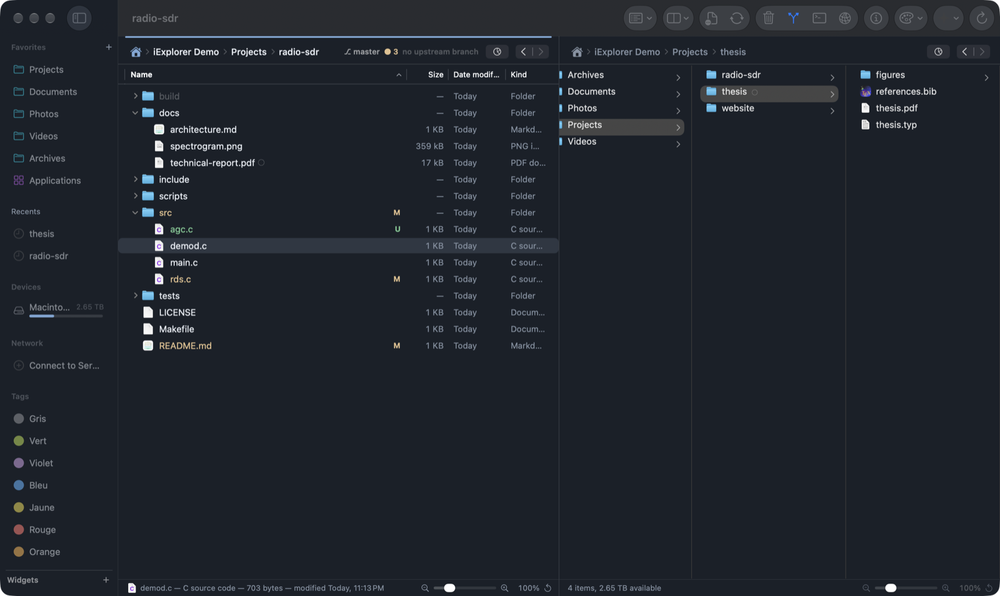
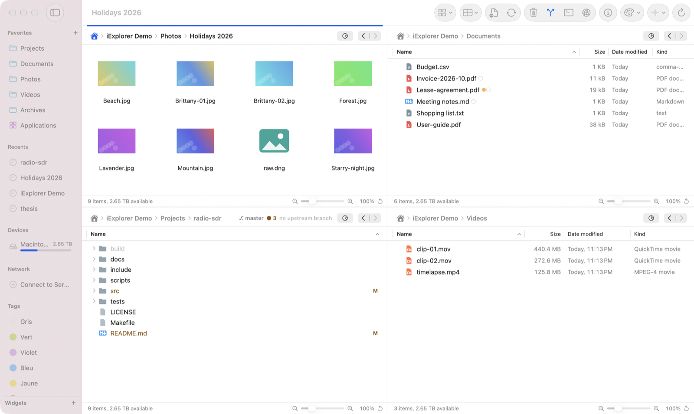
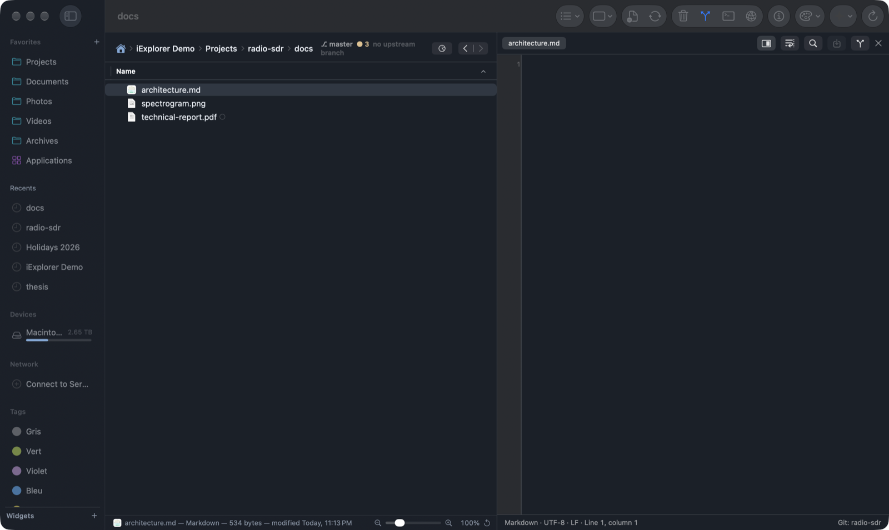
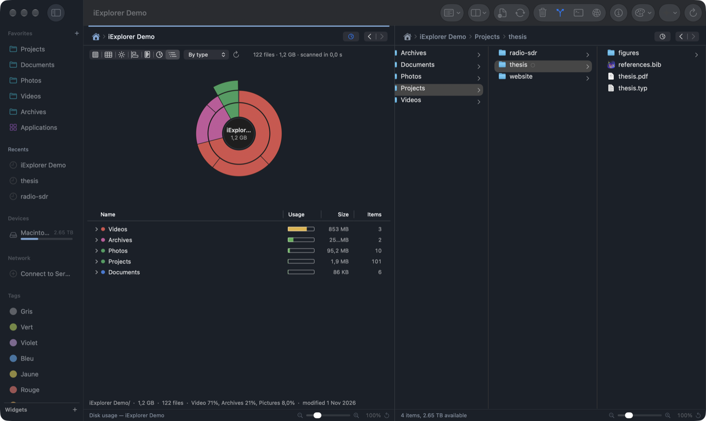
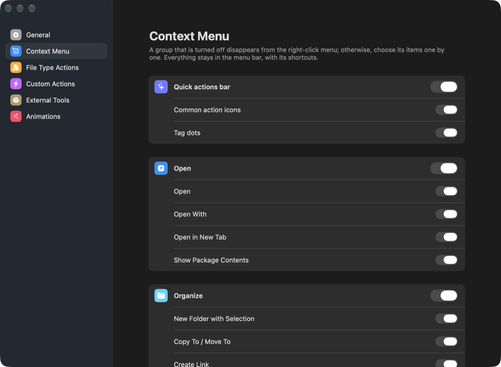
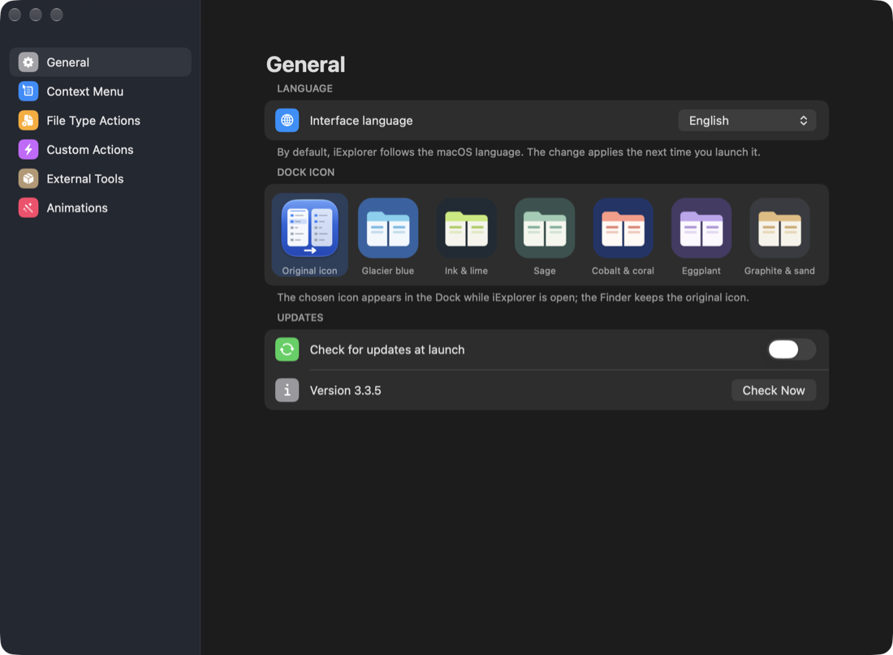
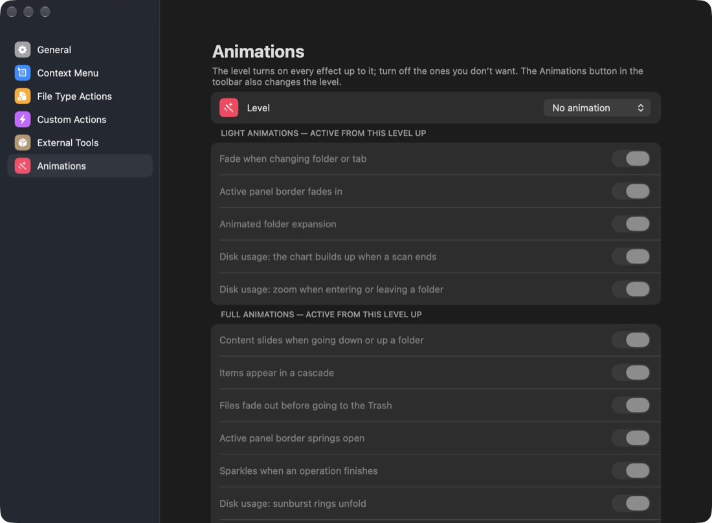

# iExplorer

**English** · [Français](README.fr.md)

**A native file manager for macOS**: up to four panels with tabs, Git status, an editor with live preview, a built-in
terminal, remote servers, disk usage analysis and themes. Written in Swift / AppKit, no Electron.



## Why iExplorer?

- **Several folders in sight.** 1 to 4 side-by-side panels, each with its own tabs; F5 / F6 copy or move to the other
  panel, as in classic dual-pane file managers.
- **Made for projects.** Git status shows up in the lists, an editor with preview opens next to your files, and the
  built-in terminal follows the current folder.
- **Where did the disk space go?** ⌘5 turns any folder into a disk usage chart.
- **Make it yours.** 20 color themes in light and dark, 13 icon themes, a configurable context menu, a choice of Dock
  icons, animations from subtle to spectacular, and an English or French interface.

## Screenshots

### Four panels, light theme

Icons, details, list and columns in one window, with Finder tags and Git status.



### Editor with live preview

In the single-panel layout, the editor opens next to the panel: live Markdown, CSV and JSON preview, LaTeX or Typst
builds with the PDF alongside, and syntax highlighting for more than seventy languages.



### Disk usage (⌘5)

The current folder in seven charts (treemap, sunburst, histogram, Baobab-style list), animated at the level you choose.



### Settings that fit your way of working

| | |
|---|---|
|  |  |
| **Context Menu**: hide a whole group, or items one by one. | **General**: interface language, Dock icon, updates. |



**Animations**: one level (none, light, full, Whaouh+++) and one switch per effect. The macOS “Reduce motion” setting
is always honored.

## Features

**Navigation**
- English or French interface: follows the system language by default, configurable in Settings › General.
- 1, 2, 3 or 4 panels (8 layouts), each with colored tabs and its own status bar (selection, zoom).
- Icon, list, details and column views; folders expand in place in lists; grouping by kind, date or size; flat view of a whole tree.
- Synchronized navigation across panels, folder comparison and synchronization, search (name, content, tags).
- Archives (zip, tar.gz, 7z, rar…) browsed like folders.

**Files**
- Background copies and moves, with throughput, pause and optional verification.
- Drag and drop between panels, with the Finder and other apps, in every view.
- Batch rename, Finder tags, new documents from templates, sharing, undo (⌘Z).
- Compression, checksums, encryption, splitting large files.
- Inspector: highlighted code preview, PDF, images, video and audio, permissions (R/W/X, octal, owner).

**For developers**
- Git status in the lists, as in VS Code; stage, commit, pull and push from the inspector.
- Built-in terminal that follows the active panel’s folder.
- Editor next to the panel in the single layout: live Markdown, CSV and JSON preview, LaTeX or Typst builds with the PDF alongside, text ↔ PDF (SyncTeX) and text ↔ Markdown preview sync with ⌘-click, lines changed since the last commit marked in the gutter, syntax highlighting for more than seventy languages (Makefile, CMake, VHDL, Verilog, Tcl and FPGA constraints, SPICE, Typst, BibTeX, Matlab, Chisel, YAML, Terraform…).
- Custom actions and per-file-type actions (Makefile targets, build a .typ, convert a .md…).
- Optional external tools (7-Zip, unar, pigz, LaTeX, Typst…) installed in one click through Homebrew.
- SFTP, SMB, AFP, NFS and WebDAV servers.

**Appearance**
- 20 color themes, each in light and dark; automatic, light or dark appearance.
- 13 file icon themes, 7 Dock icons.
- Four animation levels, adjustable effect by effect.

**Disk space**
- Disk usage of the current folder (⌘5) in 7 charts: treemap, sunburst, histogram, Baobab-style list.
- Move to Trash straight from the chart, rescan in one click.

## Installation

Requires **macOS 26** or later.

1. Download `iExplorer-x.y.z.dmg` from the [Releases](https://github.com/blegal/iExplorer/releases/latest) page.
2. Open the disk image and drag **iExplorer** to **Applications**.
3. The app is not notarized by Apple: on first launch, **right-click › Open**, then confirm.
   You can also remove the quarantine attribute:

   ```bash
   xattr -dr com.apple.quarantine /Applications/iExplorer.app
   ```

Updates are then automatic. The app checks for new versions at launch, or on demand with
**iExplorer › Check for Updates…**. Every disk image is signed (Ed25519) and verified before it is installed.

### Build from source

You need Xcode with Swift 6.

```bash
git clone https://github.com/blegal/iExplorer.git
cd iExplorer
./build.sh
open build/iExplorer.app
```

## Essential shortcuts

| Action | Shortcut |
|---|---|
| Next panel | ⇥ |
| Copy / move to the other panel | F5 / F6 |
| Rename | F2 |
| Quick Look | Space |
| Icons, list, details, columns | ⌘1 … ⌘4 |
| Disk usage | ⌘5 |
| 1 to 4 panels | ⌥⌘1 … ⌥⌘4 |
| Search | ⌘F |
| Connect to server | ⌘K |
| Built-in terminal | ⌃\` |

## Learn more

The [detailed guide](docs/GUIDE.md) (in French) covers every feature and the full list of shortcuts. It also explains
the format of per-file-type actions, how releases are published and how updates are signed.

Disk usage analysis and automatic updates are shared with [iBaobab](https://github.com/blegal/iBaobab), the disk
usage analyzer.

## Development

iExplorer was developed with the help of [Claude Code](https://claude.com/claude-code), Anthropic’s coding assistant.
